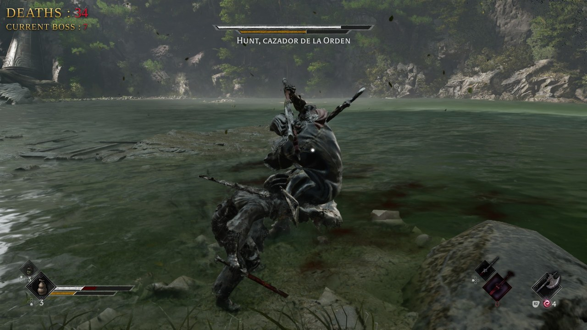

# ⚔️ Automatic Death Counter for OBS — Phantom Blade Zero

An OBS overlay that **counts your deaths on its own**. It detects the game's death screen, knows when you're fighting a boss, and resets the boss counter when you win. No buttons needed.



- **DEATHS**: your total for the playthrough. Goes up every time the **DEAD** screen appears.
- **CURRENT BOSS**: shows up when a boss health bar appears, counts your deaths against that boss, and goes back to 0 (and hides) when you defeat it.

It's a single HTML file — nothing to install. Made by [MistyWaifu](https://twitch.tv/mistywaifu).

---

## Requirements

- **OBS Studio 28 or newer** (WebSocket is built in).
- **Phantom Blade Zero** captured in OBS **full screen at 16:9** (1920×1080, 2560×1440, etc.).
- Optional: a **Stream Deck** with Elgato's official **OBS Studio** plugin, for manual corrections.

---

## Setup

### 1. Download the file

Download `contador-muertes.html` from this repo (**Code → Download ZIP**, or open the file and click the download icon). Save it in a folder you won't move, for example `Documents\stream`. If you move it later, you'll need to select it again in OBS.

### 2. Turn on OBS WebSocket and copy your password ⚠️

The counter **will not work** without this step.

1. In OBS, go to **Tools → WebSocket Server Settings**.
2. Check **Enable WebSocket server**.
3. Leave the port at **4455**.
4. Keep **Enable Authentication** checked. If the password is empty, click **Generate Password**.
5. Click **Show Connect Info** → **Copy** next to *Server Password*.
6. Click **Apply**, then **OK**.

> 🔒 **Never show the *Connect Info* window on stream.** Anyone on your network with that password could control your OBS. If it ever shows up on stream, generate a new one.

### 3. Add your password to the file

Open `contador-muertes.html` in **Notepad** (right-click → *Open with* → *Notepad*) and find this line near the top of the code:

```js
const OBS_PASSWORD = 'YOUR_PASSWORD_HERE';
```

Replace `YOUR_PASSWORD_HERE` with the password you copied, **keeping the quotes**:

```js
const OBS_PASSWORD = 'aB3xYz9QwErTy123';
```

Save with **Ctrl + S**.

### 4. Name your game capture `JUEGO`

In **Sources**, right-click the source that captures the game (*Game Capture* or *Window Capture*) → **Rename** → type `JUEGO` in capital letters.

The counter looks for the death screen **inside that source**, not your whole scene, so your webcam or alerts on top of the game won't confuse it. (Want a different name? See [Customize](#customize).)

### 5. Add the counter to your scene

1. **Sources → + → Browser**.
2. Check **Local file** → **Browse** → select `contador-muertes.html`.
3. **Width:** `440`, **Height:** `140`.
4. Click **OK** and place it wherever you like (top-left works well).

### 6. Check that it works

With OBS open, double-click `contador-muertes.html` to open it in your browser. The status is shown in the bottom-left corner:

| Message | What it means |
|---|---|
| 🟢 **OBS connected · Stream Deck ready** | All good |
| 🟢 **Detection active · DEAD 0.00 …** | It can see your game |
| 🔴 **add your password to the file** | Redo step 3 |
| 🔴 **wrong password** | The password doesn't match — copy it again (step 2) |
| 🔴 **OBS not connected** | WebSocket isn't on (step 2) |
| 🔴 **can't find the source "JUEGO"** | Check the name (step 4) |

Once everything is green, **close that browser tab**. It's only for checking, and leaving it open uses extra resources.

---

## Manual buttons (optional)

In case detection misses a death or counts one too many.

**In OBS**, add these **Text (GDI+)** sources to your game scene with **empty** text (they're invisible):

| Source name | What it does |
|---|---|
| `MUERTE` | +1 to the total |
| `MENOSMUERTE` | −1 from the total |
| `NUEVOJEFE` | Resets *Current boss* to 0 |
| `RESETMUERTES` | Resets everything to 0 |

Every time you show or hide one of these sources (click its 👁 eye icon), the counter runs that action.

Manual buttons only change the **total**. *Current boss* is only changed by automatic detection and by `NUEVOJEFE`.

---

## 🎛️ Stream Deck setup (optional)

If you have a Stream Deck, you can turn those sources into physical buttons. You **don't need** a Twitch plugin or any extra counter plugin — just Elgato's OBS plugin.

### 1. Install the OBS Studio plugin

1. Make sure your **Stream Deck app is version 6.9 or newer** (update it if the plugin won't install).
2. Install Elgato's official **OBS Studio** plugin, either:
   - from the [Elgato Marketplace](https://marketplace.elgato.com/product/obs-studio-35615969-830f-45c9-ba0a-1a295bba7fec), or
   - inside the Stream Deck app: click the **Plugins** tab on the right, search **OBS Studio**, and install the one **by Elgato**.

> Avoid third-party "death counter" or "win/lose counter" plugins for this — they keep their own number and won't talk to this overlay.

### 2. Create the sources in OBS first

Before configuring the keys, create the empty **Text (GDI+)** sources from the table above (`MUERTE`, `MENOSMUERTE`, `NUEVOJEFE`, `RESETMUERTES`) in the **same scene** where you play. If they don't exist yet, they won't show up in the Stream Deck list.

### 3. Add the keys

1. In the Stream Deck app, click the **Keys** tab and search **obs**.
2. Under **OBS Studio**, find **Source Visibility**.
3. Drag it onto an empty key (tip: use a free page, like page 2, so you don't overwrite your other buttons).
4. Click the key and configure it at the bottom:
   - **Scene:** the scene where you play (for example `GAMING`)
   - **Source:** `MUERTE`
   - **Title:** something like `+1`
5. The first time, it may ask you to connect to OBS: OBS must be **open**, and the password is the same one from step 2.
6. Repeat for the other buttons:

| Key title | Source |
|---|---|
| `+1` | `MUERTE` |
| `-1` | `MENOSMUERTE` |
| `BOSS` | `NUEVOJEFE` |
| `RESET` | `RESETMUERTES` |

### 4. Test it

Press the `+1` key with OBS open. The eye icon next to `MUERTE` should toggle in OBS, and the counter should go up by 1.

- **The eye toggles but the counter doesn't change** → the overlay isn't connected to OBS. Open the HTML in your browser and check the status message (see **Setup → step 6**).
- **The eye doesn't toggle** → check that the key has the right **Scene** and **Source** selected.

> Put `RESET` in a corner of your Stream Deck — it wipes everything and is easy to hit by accident.

---

## How it works

About twice per second, the counter asks OBS for a small screenshot of the `JUEGO` source and checks it **in memory**. Nothing is saved to your disk, and it uses very little CPU or RAM.

| What it looks for | Where |
|---|---|
| The red word **DEAD** | Bottom center |
| The frame of the **boss health bar** | Top center (works even when the boss is almost dead) |
| The white **kanji** shown when a boss is defeated | Center-right |

To avoid false positives, each one has to appear in 2 screenshots in a row, and each death is only counted once.

Deaths count toward **CURRENT BOSS** only if the boss bar was on screen (or seen in the last 12 seconds). Regular deaths only add to the total.

---

## FAQ

**Does it reset when I close OBS?**
No. The numbers are saved even if you close OBS or refresh the source. To start from zero, use `RESETMUERTES`.

**I clicked *Refresh* and it didn't go back to 0.**
That's expected — *Refresh* doesn't clear the numbers. Use `RESETMUERTES`.

**I want to start with the deaths I already had.**
Press `MUERTE` as many times as you need (outside a boss fight).

**It doesn't detect deaths.**
Make sure the game fills the whole `JUEGO` source at 16:9, with no black bars. Open the HTML in your browser and check the *DEAD* number when you die: it should go above 0.70.

**I opened the HTML in my browser and it shows different numbers.**
The browser and OBS each keep their own numbers. The one on your stream is the OBS one.

**I get *HTTP ERROR 426* when I open `http://127.0.0.1:4455`.**
That's a good sign — WebSocket is on. If you get *ERR_CONNECTION_REFUSED* instead, uncheck and recheck *Enable WebSocket server*, click *Apply*, and restart OBS.

---

## Customize

In the same settings block at the top of the HTML you can change:

- `LABEL_TOTAL` and `LABEL_BOSS`: the overlay text. For Spanish, use `'MUERTES :'` and `'JEFE ACTUAL :'`.
- `FUENTE_JUEGO`: the name of your game source, if you don't want to call it `JUEGO`.
- `FUENTE_MAS`, `FUENTE_MENOS`, `FUENTE_RESET`, `FUENTE_JEFE`: the source names used for the manual buttons.

To test without OBS, open the HTML in your browser and use the keyboard: `+` / `-` add and subtract, `J` resets the boss, `B` simulates a boss bar, and `0` resets everything.

---

## License

MIT — use it, change it, and share it freely. If you use it on stream, a shoutout to [MistyWaifu](https://twitch.tv/mistywaifu) is always appreciated! 💜
